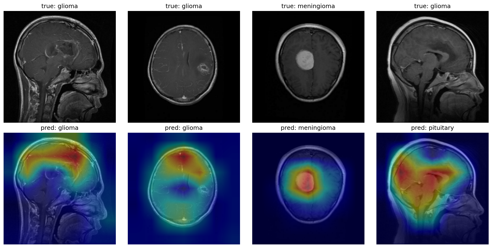
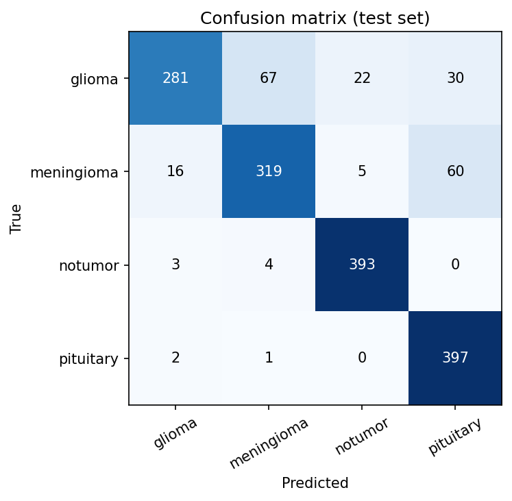

# Brain tumour MRI classification (EfficientNetV2-S)

Four-class classifier (glioma, meningioma, pituitary tumour, no tumour) on 2D MRI slices, using transfer learning from ImageNet EfficientNetV2-S, with a Grad-CAM heatmap and a web demo.

> **Research prototype. Not a medical device. Not for clinical use.** Trained and tested only on a public dataset; no patient data is included in this repository.

**Demo:** a Gradio app is in `demo/` (see Run it below). There is no hosted version yet.




## Results (held-out Testing folder, 1,600 images, 400 per class)

| Metric | Value |
|---|---|
| Accuracy | 95.4% |
| Macro F1 | 0.954 |
| Macro AUC (one-vs-rest) | 0.992 |

| Class | Recall | Precision | AUC |
|---|---|---|---|
| Glioma | 83.8% | 99.4% | 0.975 |
| Meningioma | 98.0% | 90.5% | 0.995 |
| No tumour | 100.0% | 93.9% | 0.999 |
| Pituitary | 100.0% | 99.0% | 1.000 |

Main confusions: 41 of 400 gliomas predicted as meningioma and 24 as no tumour. See `results/metrics.json` and the figures in `results/`.

An earlier version of this project (EfficientNetB0, 224 px, last 60 layers fine-tuned) reached 86.9% accuracy and glioma recall 70.3% on the same test folder. The gain comes from a stronger backbone, higher resolution and fine-tuning the whole network with a cosine learning-rate schedule. The epoch was chosen on the validation split only. I ran the same recipe twice with the same seed: both gave 95.4% accuracy and glioma recall of 84.0% and 83.8%. The numbers above are from the second run, whose model and figures are the ones saved here. Two runs are not enough to measure variation properly.

## Method

- Data: Kaggle `masoudnickparvar/brain-tumor-mri-dataset` (Training 5,600 and Testing 1,600 slices, combining figshare, SARTAJ and Br35H sources). 15% of Training was held out for validation.
- Model: EfficientNetV2-S (ImageNet) at 256 px with augmentation (rotation, zoom, shifts, contrast, horizontal flip). Phase 1: head only (Adam 1e-3, up to 8 epochs). Phase 2: whole backbone unfrozen with BatchNorm frozen (Adam, cosine decay from 3e-5, up to 25 epochs, early stopping on validation accuracy).
- Explainability: Grad-CAM.

## Limitations (read before quoting the numbers)

- Classification is per 2D slice, not per patient or volume. Near-duplicate slices from the same patient may appear in both Training and Testing, so the scores can be optimistic.
- The dataset mixes sources with different scanners and protocols and there is no external validation.
- Two runs of one recipe, same seed. Glioma is still the weakest class (recall 83.8%): about one in six is missed or mislabelled, so this model would not be usable for screening.
- Grad-CAM shows where the network looked, not that it found a lesion.

## Run it

Train (Google Colab, GPU runtime): open `brain_tumor_mri_training.ipynb` and run all cells; it saves `brain_tumor_effnetv2s.keras` and `metrics.json`.

Demo locally:

```bash
cd demo
pip install -r requirements.txt
# put brain_tumor_effnetv2s.keras in this folder
python app.py
```

## Author

Abdullah Ghani, data and AI engineering student at ECE Paris.
